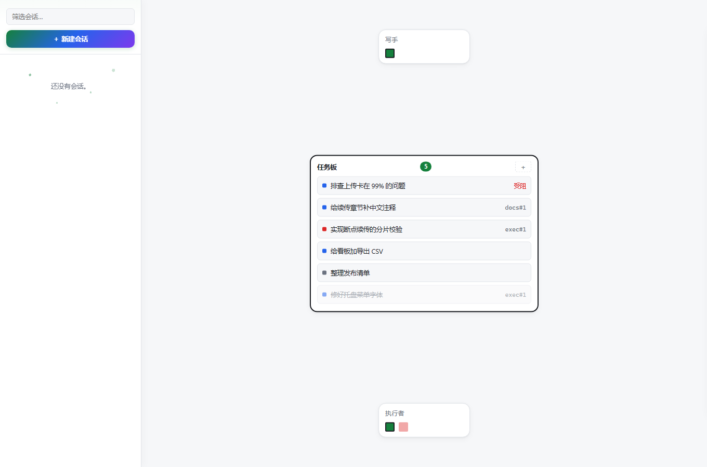
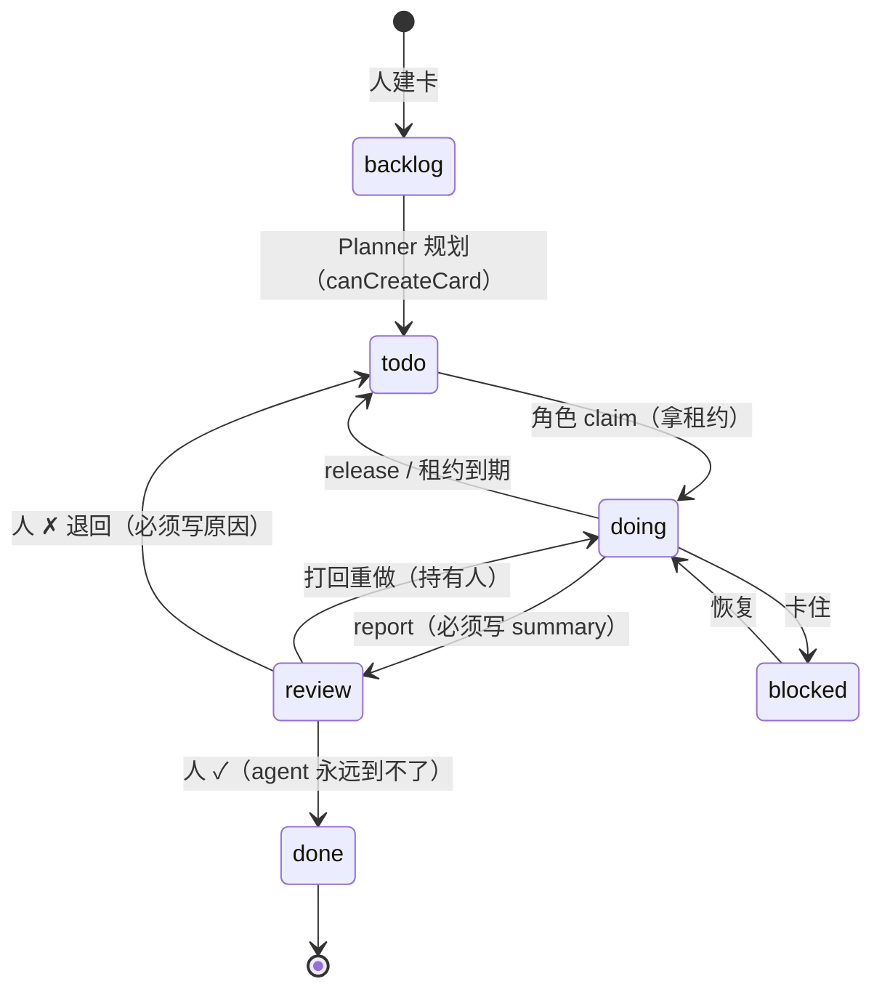
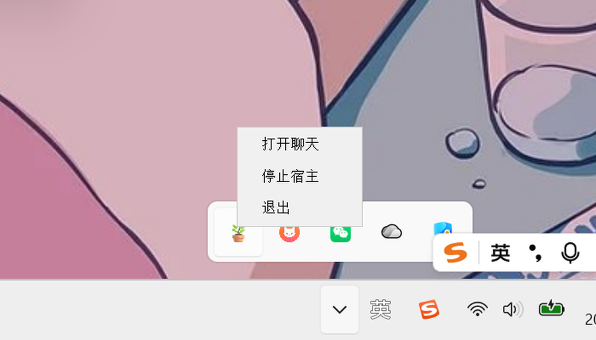

# Pot

**单机常驻角色 + 任务看板的本机 Agent 宿主。** 你给一句话目标，Planner 把它变成看板上的一张卡，
常驻角色自己认领、执行、写回报，你只负责在「待验收」那一列点 ✓。



（英文界面：`board-en.png`；同一套皮、同一份数据，语言在顶栏切换。）

## 它是什么

一台机器、一个宿主进程、几个常驻角色、一块看板。没有房间、没有多机、没有云。

- **角色（Role）**：`planner` 是系统种下的主控，能把目标拆成卡片；`executor` 是干活的手。
  角色表在盘上（人掌权），可新建/编辑/删除；模板派生保证 agent 建的角色拿不到额外权限。
- **看板（Board）**：六列——待规划 / 待办 / 进行中 / 待验收 / 已完成 / 受阻。
  进「进行中」要拿租约，租约到期自动被规则收走；只有人能在「待验收」点 ✓ 或 ✗（退回必须写原因）。
  列内新卡在上、每列只显示最近 12 张，更早的进归档（按日期分组、可按标签/角色筛，不删卡）；
  卡片是一行紧凑卡，点开详情看描述/清单/报告/评论并在里面操作。
- **聊天**：浏览器里的 WebUI（启动器「打开聊天」带 token 拉起），流式输出、工具卡、耗时读数、子代理卡。

三个部件：

| 部件 | 技术 | 位置 |
|---|---|---|
| 宿主 | Python 3.13 | `pot/` —— 看板引擎、角色、工具面、HTTP（hub + WebUI 同进程） |
| 启动器 | Kotlin + Compose Multiplatform 1.12.2 | `launcher/` —— 看板页 / 设置 / 关于 / 托盘 / 宿主生命周期 |
| 聊天界面 | 原生 JS（无构建） | `web/` —— 由宿主的 loopback 服务器直接发出 |

## 快速开始

前置：Windows（v1 目标）、Python **3.13**、JDK **17**。

```powershell
# 1. 依赖
git clone https://github.com/Offblink/Pot.git pot; cd pot
pip install -e .

# 2. 起宿主（人肉用它就够了：WebUI + hub 一起起来）
python -m pot --web
#    Pot WebUI: http://localhost:<port>
#    Pot Hub:   http://127.0.0.1:<port>

# 3. 或者起启动器（推荐：看板 + 托盘 + 一键拉起宿主）
cd launcher
gradle --no-daemon run          # 首次会拉 Compose 依赖；本机已有 9.5.0 缓存
```

第一次打开 WebUI 会弹配置框：填 **endpoint / API Key / 模型名**（存在仓库根目录的
`config.json`，已 gitignore）。启动器「设置」页也能改，并会读 `/model` 回显当前模型。

启动器默认 **自动拉起宿主**（设置页可关）；「打开聊天」在顶栏，host 跑着才可用。

## 看板怎么跑

1. 顶栏「打开聊天」→ WebUI 里说一句话，例如「把 README 里过期的地方找出来」。
2. Planner 建卡（可带标签/优先级/角色），卡片落「待办」。
3. 角色按标签认领 → 「进行中」，拿租约（可续租）。
4. 角色干完 → 写回报 → 「待验收」。
5. 你在启动器里点 **✓ 完成**（或 **✗ 退回** 并写原因）；退回的原因进卡片评论，角色下次开工必读。

卡片必须自足：角色只看得到这张卡，看不到你的聊天上下文。

## 分工是怎么产生的

分工不是模型在提示词里「扮演」，也不是编排代码里写死的流程图。它是**三样东西的交集**：盘上的角色、
卡片上的标签、认领时的校验。

**角色从哪来**，三条路，权限面都收在人手里：

| 来源 | 谁建 | 能定什么 |
|---|---|---|
| 系统种子 | 宿主首次启动 | 只有 **`planner`**（`wip 1`、不可认领、可建卡、无工具）；删掉文件也会重新种回来 |
| 模板派生 | Planner 建 | **必须**带 `template`（否则 `need_template`），`tools / model / wip / canCreateCard` 全部继承模板；自己写这些字段或写 `isTemplate` 一律被拒（`planner_no_privilege`） |
| 人直接建 | 人在启动器「角色」页 | 全部字段；改权与删除**只有人**能做（`update`/`delete` 非 human 直接拒） |

（本机装好的 `executor` 就是「人直接建」的：`canClaim []` 表示不限标签、`wip 1`。模板只有人能把某个角色标成
`isTemplate`。）

所以「谁干什么」不是靠一句「你是审查员」的提示词，而是：角色有一份**可认领标签集**（`canClaim`：
列表=只认这些标签，空=不限，`false`=禁止），卡片带标签，认领时逐条比对——对不上就是 `role_mismatch`，
和模型自己的意愿无关。

**为什么这样切**：权限面（工具、模型、并发数、能否建卡）只从人这里流向磁盘；Planner 只能在人划定的
模板里造新角色。这样「agent 给自己开权限」在代码层就没有路径——它连字段都写不进去。

## Taskboard 机制

卡片是这个系统里唯一的工作单元：一行 sqlite 记录，一条有闸门的状态机。

**状态与转移**



- 进 `doing` 必须**持卡**（`already_held` 挡第二个认领者）。
- 租约默认 **900 秒**，只在 `doing` 走；进 `review`/`blocked` 清空，回 `doing` 重挂。过期由看板的
  清扫逻辑（Gate 7）退回 `todo`、清 holder、留一条系统评论；人也能手动续租。
- **WIP** 是每个角色自己的配额（新建默认 2，系统种下的 `planner` 是 1），满了就 `wip_full`——并发是配额，不是自觉。
- 写回报要有 summary（`need_summary`），退回要有原因（`need_reason`），勾清单要有证据（`need_evidence`）。

**七道闸**（全部在代码里，不是提示词里的约定；违反即拒，错误码就是契约）：

| 闸 | 规则 | 违反返回 |
|---|---|---|
| 角色匹配 | `labels ⊆ role.canClaim`，且卡片点名的角色对得上 | `role_mismatch` |
| WIP | 该角色持有的卡数 < `wip` | `wip_full` |
| 持有保护 | 已有 holder 的卡不能被第三方抢 | `already_held` |
| 乐观锁 | 写入必须带对 `ifVersion` | `stale_version` |
| done 闸 | agent 永远到不了 `done`，最高到 `review`；`done` 只能人点 | `human_only` |
| 退回 | 人 ✗ 退回 `todo`，原因写进卡片评论（角色开工前必读） | `need_reason` |
| 租约 | 超时 → 自动回 `todo`、清 holder、评论留痕 | — |

其余路径另有各自的码，同样会拒：`not_holder`（不是持有者却想改）、`bad_transition` / `bad_status`
（状态机里没有这条边）、`cant_create`（没有建卡权）、`need_summary` / `need_evidence` / `need_text`
（回报、清单证据、退回原因缺失）、`no_such_card` / `no_such_role`。

**并发**：每张卡带 `ifVersion`，每次写入都要带上你看到的版本，过了就 `stale_version` 打回，界面回到
真实数据而不是幽灵状态；存储是 sqlite WAL + 每次操作一个 `BEGIN IMMEDIATE`，所以「8 个角色抢 40 张卡」
在压测里恰好一个赢家。

**人掌权的地方**只有四处：✓ 完成、✗ 退回（必须写原因）、改派/删除、角色的定义与权限。其余全部可由
角色自己推进。

为什么 `done` 一定得人点：**不让 agent 给自己判卷**。它能自己验收的话，「做完」就退化成「它认为做完」，
看板也就不再提供外部确认。想放宽时按卡分级（机械可判定的卡带证据自动过闸），而不是拆掉这道闸。

**事件驱动**：每一轮结束时宿主做三件事——补投这轮跑着时完成的后台作业、把新可认领的卡派给空闲的
角色会话、卡进入 `review` 时给 Planner 留一条提示。所以工作不依赖「某一轮对话还活着」：这一轮结束了，
卡还在盘上，下一个认领者从卡本身开始干。

## 和传统做法比

**vs. 传统非事件驱动的 agent（单轮线性）**

那种形态是一条线：`用户 → LLM → 工具 → LLM → … → 最终答复`。好处是简单，代价是：

| 维度 | 单轮线性 | Pot 看板 |
|---|---|---|
| 工作状态 | 在对话上下文里，轮次结束即消失 | 在 sqlite 里的一行，跨轮次、跨进程存活 |
| 并发 | 一次消息里的多个 tool call | 多角色各自持卡，受 WIP 与租约约束 |
| 长任务 | 要么阻塞这一轮，要么被 abort 丢掉 | 进入 `doing` 有租约，进程重启后仍在 |
| 人的位置 | 只能在中途插一句（ask 卡）或等结束 | 在 `review` 这一列做验收，之前不打扰 |
| 失败 | 一句错误文本 | 卡进 `blocked`，退回原因写进评论，下次开工必读 |
| 可观测 | 读转录 | 看板就是状态；每张卡有版本、持有者、租约、评论 |

**vs. subagent 机制**

subagent 的分工是**调用者临时决定**：父代理 `spawn(layer, goal, reply_format)`，子代理跑完把一段文本
交回来，父代理继续。它解决的是「一次调用里多一个上下文」，不解决「一件工作需要被持续负责」：

| 维度 | subagent | Pot 看板 |
|---|---|---|
| 身份 | 临时的，进程/调用结束即消失 | 角色是盘上的记录，有 id、权限面、创建者 |
| 权限 | 由父代理的提示词决定 | 由模板派生 + 代码校验，agent 改不动自己的权限 |
| 工作单元 | 一次调用 + 一个字符串返回值 | 一张卡：状态、标签、租约、评论、报告、版本 |
| 交接 | 只能同步等，或后台跑完唤醒父代理 | 任何符合标签的角色都能认领；原会话不在也照跑 |
| 并行 | 父代理 spawn N 个然后等 | 各角色按 WIP 配额并行，卡不需要同一个父上下文 |
| 人的介入 | 事后读子代理的转录 | 在验收列做决定，退回原因结构化地回到卡上 |
| 失败 | 变成一个失败的工具调用 | 卡被退回/阻塞，原因和状态都留在盘上 |

一句话：subagent 是**一次性的调用**；看板是**可被接管的工作**。Pot 里 Planner 只写卡不干活，活由
有权限、有配额、有租约的角色按标签认领——分工因此是数据，而不是提示词。

## 语言与托盘

- **语言**：顶栏 `中文 / English` 一处开关，同时管启动器与 WebUI——启动器立刻重绘，WebUI 下次
  刷新生效（写进 `config.json` 的 `ui_lang`，由 `/lang.js` 提供）。
- **托盘**：启动器进程活着托盘就在。**关窗 = 收进托盘**（宿主继续跑，看板照常推进），左键把窗口叫回来；
  右键菜单：显示窗口 / 打开日志 / 打开聊天 / 停止·启动宿主 / 退出 —— 退出只走这一项。菜单向上弹（不盖任务栏），
  点别处即关。
- **图标**：🪴 —— 托盘、标题栏/任务栏、关于页同一张。



## 目录

```
pot/            宿主：board.py(看板引擎) roles.py tools/ server.py hub/ session.py …
launcher/       CMP 启动器（Kotlin；Standalone Gradle build）
web/            浏览器 WebUI（index.html + app.js/common.js/i18n.js/motion.js/style.css）
tests/          pytest（含 Playwright 真浏览器用例）
docs/           spec.md（v1.0 定稿，唯一权威）+ images/
scripts/        launcher-click-complete.ps1（UI 验收点击）、dump_prompts.py、check.ps1
```

## 开发与门禁

```powershell
python -m ruff check . && python -m ruff format --check .
$env:PYTHONIOENCODING="utf-8"; python -m pytest tests -q     # 486 passed
cd launcher; gradle --no-daemon compileKotlin                # 启动器编译
```

UI 验收脚本（需启动器已跑、且「待验收」列里有卡）：

```powershell
powershell -File scripts/launcher-click-complete.ps1 -DryRun   # 只报坐标
powershell -File scripts/launcher-click-complete.ps1           # 真点
```

它不写死像素：按调色板主色（浅色 `#15803D` / 深色 `#4ADE80`）在页头下方找药丸大小的实心块，
窗口移动或缩放都不影响。

## 现状与边界（v0.1）

- 单机单人：没有多机房间、文件传输、好友、移动端（都在 M2a 从 Fungi 平移时砍掉了）。
- Windows 优先；macOS/Linux 结构预留但没验过。
- 不做自动更新。
- **安装包还没做**（M5 未完成的最后一块）：目前是源码跑 `gradle run`。打包时要把 Python 宿主的
  部署形态一起定下来（自备 Python 还是要塞进安装包）。
- 版本号只在 `pyproject.toml` 一处，启动器构建时读它生成常量，安装包也用同一个值。
